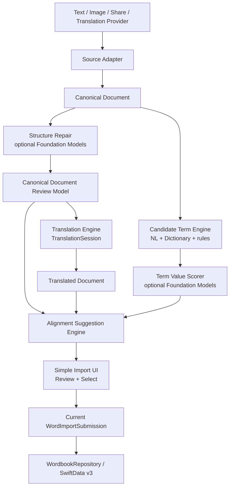

# Unified Import Document Pipeline Technical Design

- **Status:** Approved for Phases 1-4; Phases 5-6 remain pending approval.
- **Date:** 2026-11-06
- **Baseline branch:** `zhezhe-star/apple-intelligence`
- **Scope:** Text, image, Share Extension, and Translation Provider import can be normalized into one document pipeline while the user-facing import UI stays simple.
- **Execution cutline:** Phases 1-4 are authorized for implementation; later phases require separate approval.

## 1. Product goal

WordMem should turn any imported source into three reusable views of the same content:

1. **Canonical Document** — the normalized original content with stable structure.
2. **Translated Document** — the translated content aligned to canonical blocks/spans.
3. **Candidate Terms** — high-value words extracted from the original document and aligned to its context.

The user should not need to understand or see this pipeline. The product presents one simple import flow: choose or paste content, wait briefly, review the result, select words, and save.

## 2. Current problems

| Area | Current behavior | Consequence |
|---|---|---|
| Image OCR | `VisionTextRecognitionService` uses `VNRecognizeTextRequest` and returns `[String]`. | Titles, paragraphs, lists, tables, word positions, reading order, and confidence are lost. |
| Translation | `ImportCandidateTranslationModifier` creates `en → zh-Hans`, calls `translate(batch:)`, and has an empty `catch`. | Every failure becomes “整段翻译暂不可用”; unsupported/needs-download/failed states cannot be distinguished. |
| Candidate extraction | Regex splitting, lemma, spelling, and Apple Dictionary gating are used, but candidates are not tied to a stable document tree. | Candidate context is weak and future上下文复习/alignment cannot reuse the import result. |
| Import UI | Text import uses a large sheet, `TextEditor`, and has no explicit focus/keyboard management. | Keyboard dominates the screen during review; low-level processing states leak into UX. |
| Source models | Text and image paths build ad hoc chip collections. | The same source cannot be rendered consistently or persisted as reusable context. |

## 3. Design principles

1. **One canonical representation.** Every source first becomes a `CanonicalDocument`. No downstream stage consumes raw OCR strings or ad hoc chip arrays.
2. **Specialized frameworks first.** Vision handles document recognition; Translation handles translation; NaturalLanguage and Apple Dictionary handle deterministic lexical facts.
3. **Foundation Models is an assistant, not the source of truth.** It may repair structure, score existing terms, explain context, and suggest alignment, but it must not invent source text or replace deterministic storage rules.
4. **Users confirm model output.** AI-generated structure, translations, glosses, and alignments are suggestions until accepted or edited.
5. **UI hides the pipeline.** The frontend shows semantic states only: preparing content, translating, selecting words. It never exposes Vision/Foundation Models/Translation framework terminology.
6. **Local-first remains unchanged.** No backend corpus is introduced. Apple Dictionary remains the word capture gate. Only user-confirmed translations are stored in the wordbook.

## 4. Target architecture



### 4.1 Components

| Component | Responsibility |
|---|---|
| `ImportSourceAdapter` | Converts typed text, pasted text, image bytes, share payloads, and provider payloads into one normalized input envelope. |
| `DocumentCanonicalizer` | Builds stable block/span IDs, paragraphs, lists, tables, headings, captions, and geometry. |
| `VisionDocumentReader` | Uses iOS 26 `RecognizeDocumentsRequest` for images and maps `DocumentObservation` into canonical blocks/spans. |
| `FoundationDocumentRepairer` | Optional. Repairs reading order, titles, list nesting, OCR line merges, and table captions using structured output constrained to existing IDs. |
| `DocumentTranslationEngine` | Runs `LanguageAvailability`, prepares/requests translation, uses `TranslationSession.Strategy.highFidelity`, and produces a `TranslatedDocument`. |
| `CandidateTermEngine` | Tokenizes canonical spans and applies stopwords, lemma, spelling, dictionary availability, and deterministic value rules. |
| `TermSuggestionEngine` | Optional Foundation Models scorer. Can only reference existing candidate IDs and cannot add new words. |
| `AlignmentSuggestionEngine` | Produces block-level guarantees and token/fragment alignment suggestions. |
| `ImportDocumentSession` | Owns the in-memory document bundle and exposes simple UI states. |
| `ImportDocumentBundleStore` | Optional later persistence layer. v1 can remain in-memory and submit selected words through the existing repository path. |

## 5. Canonical data model

### 5.1 Document

```swift
struct CanonicalDocument: Identifiable, Codable, Hashable, Sendable {
    let id: UUID
    let origin: CanonicalOrigin
    let detectedLanguage: Locale.Language?
    let blocks: [CanonicalBlock]
}

enum CanonicalOrigin: String, Codable, Sendable {
    case typedText
    case pastedText
    case image
    case shareExtension
    case translationProvider
}
```

### 5.2 Blocks and spans

```swift
struct CanonicalBlock: Identifiable, Codable, Hashable, Sendable {
    let id: UUID
    let order: Int
    let kind: CanonicalBlockKind
    let text: String
    let spans: [CanonicalSpan]
    let geometry: CanonicalGeometry?
    let confidence: Double
}

enum CanonicalBlockKind: String, Codable, Sendable {
    case title
    case heading
    case paragraph
    case list
    case listItem
    case table
    case tableCell
    case code
    case caption
    case quote
}

struct CanonicalSpan: Identifiable, Codable, Hashable, Sendable {
    let id: UUID
    let text: String
    let charRange: Range<Int>
    let confidence: Double
    let geometry: CanonicalGeometry?
}

struct CanonicalGeometry: Codable, Hashable, Sendable {
    let normalizedBoundingBox: CGRect
    let readingOrderHint: Int?
    let alignment: CanonicalTextAlignment?
}
```

Rules:

- IDs are generated once and remain stable while the user edits within one import session.
- `charRange` is measured against the owning block text.
- Geometry is optional; typed/pasted text has no geometry.
- Markdown is a rendering/export format, not the canonical storage format.

## 6. Structure extraction

### 6.1 Typed and pasted text

The text adapter should be deterministic first:

1. Normalize whitespace and nonprinting characters.
2. Split paragraphs by blank lines and stable line clusters.
3. Detect list markers, quote markers, code fences, and headings.
4. Preserve line breaks inside code blocks.
5. Build canonical blocks and spans.

Foundation Models may refine ambiguity, but typed text should remain usable without it.

### 6.2 Image input

Replace the current `[String]` OCR service with a document reader based on `RecognizeDocumentsRequest`:

```text
CGImage
  -> RecognizeDocumentsRequest
  -> DocumentObservation
  -> title / text / paragraphs / tables / lists / lines / words
  -> CanonicalBlock + CanonicalSpan
```

Vision should provide:

- reading-order evidence from geometry;
- paragraph boundaries;
- list/table structure;
- word/line confidence;
- normalized bounding boxes.

The existing `OCRTextSanitizer` must not mutate the canonical tree. It can filter obvious UI chrome before display or candidate extraction, but the raw canonical evidence should remain available for review and debugging.

### 6.3 Foundation Models structure repair

Foundation Models receives the Vision-derived blocks and returns a repair plan, not a replacement document:

```swift
@Generable
struct DocumentRepairPlan {
    @Guide(description: "Ordered existing block IDs. Do not introduce unknown IDs.")
    let orderedBlockIDs: [String]

    @Guide(description: "Existing block IDs to merge into one paragraph or caption.")
    let mergeGroups: [DocumentRepairMergeGroup]

    @Guide(description: "Existing block IDs that should become titles or headings.")
    let headingBlockIDs: [String]

    @Guide(description: "0-1 confidence for the whole repair plan.")
    let confidence: Double
}
```

Validation constraints:

1. Every referenced ID must exist in the canonical document.
2. The repaired text must be composed from existing block/span text.
3. Low-confidence repairs must be marked `needsReview`.
4. The user can dismiss AI repair and return to the deterministic Vision result.
5. No cloud/document cache is introduced.

## 7. Translation design

### 7.1 Availability and lifecycle

Before translating, expose a typed state:

```swift
enum DocumentTranslationPhase: Equatable, Sendable {
    case idle
    case checkingAvailability
    case needsLanguageDownload
    case unsupportedLanguagePair
    case translating
    case completed
    case failed(reason: DocumentTranslationFailure)
}
```

The engine should use:

1. `LanguageAvailability(preferredStrategy: .highFidelity)`;
2. `status(from:to:)`;
3. `TranslationSession.Configuration(preferredStrategy: .highFidelity)`;
4. `.translationTask` in the SwiftUI review surface;
5. explicit handling for unsupported, not installed, language detection failure, and internal failure.

The main app target is iOS 27.0, so the iOS 26.4 strategy API is directly available there. Share Extension and Translation Provider remain availability-gulated until their targets are deliberately updated.

### 7.2 Block translation

Translation should operate at paragraph/segment level, not as one opaque document string:

```text
CanonicalBlock
  -> semantic translation segments
  -> AttributedString with blockID/spanID custom attributes
  -> TranslationSession
  -> TranslatedBlock
```

`AttributedString` custom attributes are used to preserve block/span provenance through translation where the system supports formatting preservation. If the system cannot preserve a span attribute, the translated block remains valid at block level and token alignment becomes a lower-confidence suggestion.

### 7.3 Translated model

```swift
struct TranslatedDocument: Identifiable, Codable, Hashable, Sendable {
    let id: UUID
    let sourceDocumentID: UUID
    let targetLanguage: Locale.Language
    let blocks: [TranslatedBlock]
}

struct TranslatedBlock: Identifiable, Codable, Hashable, Sendable {
    let id: UUID
    let sourceBlockID: UUID
    let text: String
    let attributedSnapshot: Data?
    let spans: [TranslatedSpan]
    let state: DocumentTranslationState
}

enum DocumentTranslationState: String, Codable, Sendable {
    case systemTranslated
    case userEdited
    case failed
    case unsupported
    case needsReview
}
```

User edits always win over system output and change the state to `userEdited`.

## 8. Candidate term design

### 8.1 Deterministic extraction

The existing deterministic stack remains the foundation:

```text
CanonicalSpan
  -> word tokenization
  -> normalized key
  -> NaturalLanguage lemma
  -> UITextChecker spelling suggestion
  -> stopword / function word / symbol / number filtering
  -> Apple Dictionary availability
```

This produces `CandidateTerm`s tied to stable document context:

```swift
struct CandidateTerm: Identifiable, Codable, Hashable, Sendable {
    let id: UUID
    let surface: String
    let normalizedKey: String
    let lemma: String?
    let spellingCorrection: String?
    let blockID: UUID
    let sentenceID: UUID
    let sourceSpanIDs: [UUID]
    let dictionaryAvailable: Bool
    let deterministicValueScore: Double
}
```

Apple Dictionary remains the gate for word capture. Foundation Models must not bypass `WordbookRepository` availability checks.

### 8.2 Foundation Models scoring

Foundation Models receives only existing candidates plus bounded context:

```swift
@Generable
struct CandidateTermScore {
    @Guide(description: "Existing candidate term ID.")
    let candidateID: String

    @Guide(description: "0-1 vocabulary value score.")
    let valueScore: Double

    @Guide(description: "Short Simplified Chinese reason.")
    let reason: String

    @Guide(description: "Short contextual gloss based only on the sentence.")
    let contextualMeaning: String
}
```

Validation rules:

1. Unknown candidate IDs are discarded.
2. The model cannot create tokens not present in canonical spans.
3. Suggestions are ephemeral until the user accepts or edits them.
4. If the user accepts a contextual gloss, it is stored as the user-selected translation through the existing submission path, not as a dictionary corpus.
5. If Foundation Models is unavailable, deterministic ranking remains usable.

## 9. Alignment design

Alignment has three confidence tiers:

| Tier | Scope | Guarantee |
|---|---|---|
| Strong | Block | Translated block references canonical block ID. |
| Medium | Sentence/segment | Segments are translated in stable groups and retain source segment IDs. |
| Weak | Word/fragment | System or Foundation Models suggests which translated fragments correspond to a source candidate. |

```swift
struct TermTranslationAlignment: Identifiable, Codable, Hashable, Sendable {
    let id: UUID
    let candidateTermID: UUID
    let sourceSpanIDs: [UUID]
    let translatedSpanIDs: [UUID]
    let method: AlignmentMethod
    let confidence: Double
}

enum AlignmentMethod: String, Codable, Sendable {
    case deterministicPosition
    case translationAttribute
    case dictionaryLookup
    case foundationModel
    case userConfirmed
}
```

`userConfirmed` always overrides other methods.

## 10. Import document bundle

The in-session result should be one object:

```swift
struct ImportDocumentBundle: Identifiable, Codable, Hashable, Sendable {
    let id: UUID
    let canonicalDocument: CanonicalDocument
    let translatedDocument: TranslatedDocument?
    let candidateTerms: [CandidateTerm]
    let alignments: [TermTranslationAlignment]
    let selectedTermIDs: Set<UUID>
}
```

v1 persistence contract:

1. Selected words continue through the existing `WordImportSubmission`.
2. The canonical/translated/candidate bundle can remain in-memory.
3. Do not add a new SwiftData schema in the first implementation.
4. A later phase may persist bundles for document review/review flows after the processing pipeline is validated.
5. AI suggestions are not stored as dictionary content.

## 11. User-facing UI

### 11.1 Principle: hide the backend pipeline

The UI has two user tasks:

1. provide content;
2. confirm what to keep.

It does not show a Vision/Foundation Models/Translation pipeline. It does not show technical stage numbers or model names.

### 11.2 User-visible states

| UI state | User copy |
|---|---|
| Empty text capture | “输入或粘贴英文内容。” |
| Image processing | “正在整理内容…” |
| Document repair | “正在优化排版…” |
| Translation | “正在翻译…” |
| Candidate preparation | “正在准备单词…” |
| Translation download required | “需要下载翻译资源后才能翻译。” |
| Translation unsupported | “当前设备暂不支持这对语言的翻译。” |
| No offered words | “没有可保存的单词。可以更换内容或手动添加。” |
| Dictionary unavailable | “这些词在系统词典中不可用，暂时不能保存。” |

Do not expose “OCR failed”, “Foundation Models failed”, or “batch translation error” directly in normal UI. Internal diagnostics can keep the technical reason.

### 11.3 Import screen composition

Use one adaptive import screen, not a visible multi-stage wizard:

```text
Sheet: 导入

    [source preview / editor]

    [translation card, when available]

    [candidate chips]

    [导入 N 个单词]
```

Rules:

1. The source preview is compact and expandable.
2. Translation is optional enrichment; its failure must not block word selection.
3. Candidate chips appear only after processing reaches a usable state.
4. A single inline status area replaces multiple technical progress rows.
5. Primary CTA always shows the selected count.
6. Saving exits the import flow and returns to the wordbook with a concise success alert.

### 11.4 Keyboard and sheet behavior

| Change | Design |
|---|---|
| Sheet detents | Text import uses `[.medium, .large]`; review can expand naturally. |
| Focus | Add `@FocusState`; do not keep keyboard active after content is ready for review. |
| Keyboard toolbar | Provide “完成” to dismiss the keyboard. |
| Scroll dismissal | Use `.scrollDismissesKeyboard(.interactively)`. |
| Source editing | Editing returns focus only when the user taps the source area. |

## 12. Error handling

Every pipeline failure has two representations:

1. **Internal diagnostic:** framework error, block IDs, language pair, model availability, token count.
2. **User message:** short, actionable Simplified Chinese copy.

Minimum mapping:

| Internal condition | User message |
|---|---|
| Image data invalid | “无法读取所选图片，请更换图片后重试。” |
| No usable canonical text | “没有识别到可整理的内容。” |
| Translation not installed | “需要下载翻译资源后才能翻译。” |
| Language pair unsupported | “当前设备暂不支持这对语言的翻译。” |
| Language detection failed | “无法识别语言，可以手动选择语言或直接保存单词。” |
| Foundation Models unavailable | Continue with deterministic pipeline; no user-facing failure. |
| All candidates dictionary-unavailable | “没有可保存的单词。可以更换内容或手动添加。” |

## 13. Implementation phases

### Phase 1 — Canonical foundation

Add canonical models and adapters without changing product behavior:

- `CanonicalDocument`, `CanonicalBlock`, `CanonicalSpan`;
- text canonicalizer;
- mapping from current chips to canonical context;
- unit tests for stable IDs and paragraph/list/code parsing.

**Acceptance:** existing text import still behaves the same; canonical tests pass.

### Phase 2 — Image document reader

- Introduce `VisionDocumentReader`;
- switch image import from `VNRecognizeTextRequest` to `RecognizeDocumentsRequest`;
- map title/paragraph/list/table observations into canonical blocks;
- retain geometry and confidence.

**Acceptance:** paragraph, list, and table fixtures produce stable canonical structures.

### Phase 3 — Translation engine

- Extract translation into `DocumentTranslationEngine`;
- add explicit availability/error states;
- remove the empty catch;
- use `.highFidelity` in the main app;
- translate by canonical block/segment.

**Acceptance:** installed, needs-download, unsupported, failed, and user-edited states are distinguishable in tests and UI.

### Phase 4 — Simple import UI

- Rebuild text/image review around `ImportDocumentSession`;
- hide pipeline stages behind simple states;
- add keyboard focus management and dismissal;
- use `[.medium, .large]` sheet detents.

**Acceptance:** keyboard does not dominate review; no technical stage labels are visible.

### Phase 5 — Optional Foundation Models repair and term scoring

- Add Foundation Models repair only behind availability;
- enforce existing-ID validation;
- add candidate scoring with deterministic fallback;
- mark low-confidence output as reviewable.

**Acceptance:** unavailable model leaves the flow usable; model output cannot introduce unknown words.

### Phase 6 — Persisted document bundles

Only after the in-memory pipeline is stable:

- persist reusable document bundles;
- support future original/translation/context review;
- preserve user edits and confirmed alignments.

This phase requires a separate schema review.

## 14. Testing strategy

### 14.1 Unit tests

| Area | Required tests |
|---|---|
| Text canonicalizer | Paragraph splitting, list markers, code blocks, stable IDs, duplicate span handling. |
| Vision mapper | Fake `DocumentObservation` produces title/paragraph/list/table blocks with geometry. |
| Structure repair | Unknown block IDs rejected; merges only use existing text; low confidence becomes reviewable. |
| Translation | Installed, supported-not-installed, unsupported, language detection failure, and user-edited states. |
| Candidate extraction | Stopwords, lemmas, spelling corrections, dictionary gating, stable candidate IDs. |
| FM scoring | Unknown candidate IDs rejected; suggestions ephemeral; user acceptance becomes submission translation. |
| Alignment | Block alignment is strong; token alignment remains suggestion unless user-confirmed. |

### 14.2 Manual device tests

Test on an Apple Intelligence-capable iPhone and a non-AI/unsupported-language fallback device:

1. plain paragraph screenshot;
2. article with heading;
3. bulleted list;
4. table screenshot;
5. multi-column or screenshot UI text;
6. pasted article with markdown-like formatting;
7. short one-word text;
8. Chinese/mixed-language text;
9. offline translation;
10. missing translation language pack.

### 14.3 Regression gates

Before merge:

```sh
xcrun swift-format lint --strict --parallel <changed Swift files>
xcodebuild test -project WordMem.xcodeproj -scheme WordMem -destination 'platform=iOS Simulator,name=iPhone 17 Pro'
xcodebuild build -project WordMem.xcodeproj -scheme WordMem -destination 'platform=iOS Simulator,name=iPhone 17 Pro'
```

Manual verification should include text import, image import, Share Extension, and Translation Provider smoke flows.

## 15. Risks and mitigations

| Risk | Impact | Mitigation |
|---|---|---|
| Foundation Models unavailable | Feature degradation | Deterministic Vision/NL/Dictionary/Translation path remains mandatory. |
| OCR structure repair hallucinates | Wrong source text | FM can only reference existing IDs; output is validated and reviewable. |
| Translation token alignment is inaccurate | Confusing term context | Word alignment is weak/suggested; user confirmation wins. |
| Vision documents recognize UI chrome | Bad candidates | Keep sanitizer for candidate/display filtering without destroying canonical evidence. |
| Long documents exceed model context | Latency/failure | Process by bounded block groups; summarize/rank in batches. |
| New API expands minimum OS | Lost users | Keep extensions on current targets and availability-gate iOS 26/27 APIs. |
| Existing v3 import semantics change | Regression | v1 keeps `WordImportSubmission` and `WordbookRepository` as the only save path. |

## 16. Files expected to change

New components:

```text
WordMem/Import/Document/CanonicalDocumentModels.swift
WordMem/Import/Document/TextDocumentCanonicalizer.swift
WordMem/Import/Document/VisionDocumentReader.swift
WordMem/Import/Document/DocumentRepairEngine.swift
WordMem/Import/Document/DocumentTranslationEngine.swift
WordMem/Import/Document/CandidateTermEngine.swift
WordMem/Import/Document/TermAlignmentEngine.swift
WordMem/Import/Document/ImportDocumentSession.swift
```

Likely modifications:

```text
WordMem/TextImportView.swift
WordMem/ImageImportView.swift
WordMem/Services/VisionTextRecognitionService.swift
WordMem/Import/ImportCandidateTranslationModifier.swift
WordMem/Import/ImportContextViews.swift
WordMem/ContentView.swift
WordMemTests/*
```

No first-phase changes:

```text
WordMem/Domain/WordImportModels.swift submission wire format
WordbookRepository save semantics
WordMemStore v3 schema
WordMemShareExtension production flow
WordMemTranslationProvider production flow
```
