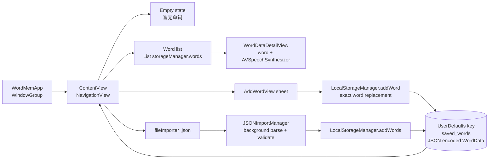
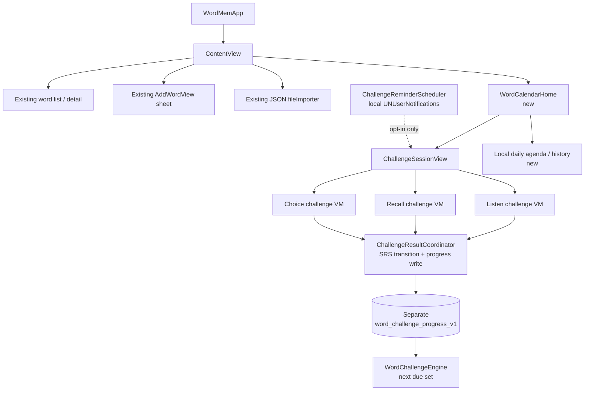

# Word Calendar: Delivery Context and Technical Integration Audit

- **Audit baseline:** `a94eb25` (`feat(words): add local single-word entry`), the current `zhangzhe/issue-6` implementation baseline.
- **Scope:** Delivery evidence, current architecture, and a non-breaking technical design boundary for issue #6 (“背单词” / Word Calendar).
- **Execution cutline:** **This is design-only work. No business implementation may begin until the user approves the product design and this architecture.** This document does not authorize Swift, Xcode project, Info.plist, entitlement, or test changes, and it does not commit anything.

## 1. Delivery context

### 1.1 Recent evidence

| Issue | Evidence and meaning for Word Calendar |
| --- | --- |
| #1 — 现状确认 | The initial native-app delivery path was validated. The recorded closure evidence says the work was merged through `fccf4b0` and “TestFlight Archive - iOS 已成功，可在 TestFlight 中继续体验.” The coordinator’s delivery evidence also validates Debug and Release simulator build and launch. Word Calendar therefore starts from a working app plus a real archive path, not from a blank project. |
| #4 — 本地单词本基础功能现状验证 | Baseline `a94eb25` introduced local single-word entry (`WordMem/AddWordView.swift`) and the current local wordbook UX (`WordMem/ContentView.swift`): empty state, word list, detail navigation, JSON import menu, manual-add sheet, and alerts. Issue #4 remains open, so this baseline should be treated as the regression surface that Word Calendar must not damage. |
| #5 — iPhone translate 和复制粘贴的插件或者 agent | A future iPhone translation/share/copy capture extension. It is not present at `a94eb25`; the only relevant integration boundary is that captured words should eventually enter the same local wordbook without Word Calendar depending on the capture mechanism. Do not couple the calendar scheduler to issue #5. |

### 1.2 Baseline interpretation

The baseline commit’s stat shows the issue #4 change touched the app target, tests, scheme, and project while removing the earlier `CloudStorageManager.swift` and `WordMem.entitlements`; there is no current iCloud/cloud code path. The design must therefore remain local-first and must not assume iCloud, a server, analytics, or an existing issue #5 extension.

The release path is separate from feature delivery: `WordMem.xcodeproj/xcshareddata/xcschemes/WordMem.xcscheme` uses Debug for test/launch and Release for profile/archive; `WordMem.xcodeproj/xcshareddata/xcodecloud/manifest.json` names the `WordMem` target; `docs/testflight-release.md` records TestFlight distribution through Xcode Cloud from `release/testflight`. Word Calendar should not change this release contract during its first implementation.

## 2. Existing architecture map

### 2.1 Source references

| Area | Source evidence |
| --- | --- |
| App entry | `WordMem/WordMemApp.swift:3-9` declares `@main struct WordMemApp` and the only `WindowGroup`, whose root is `ContentView()`. |
| Root UX | `WordMem/ContentView.swift:71-75` owns `LocalStorageManager`, `JSONImportManager`, and import UI state. `ContentView.swift:90-128` uses `NavigationView` and switches between an empty state and `List(storageManager.words)`. `ContentView.swift:109-110` opens `WordDataDetailView`. |
| Add/import surface | `ContentView.swift:130-149` is the trailing plus `Menu`; `ContentView.swift:152-156` presents `AddWordView`; `ContentView.swift:157-170` presents `.fileImporter` for JSON; `ContentView.swift:171-177` presents the result alert. |
| Manual entry | `WordMem/AddWordView.swift:3-11` observes the existing `LocalStorageManager`; `AddWordView.swift:20-23` requires non-empty word and translation; `AddWordView.swift:76-89` trims fields, creates a `WordData`, and calls `addWord`. |
| Detail and speech | `WordMem/ContentView.swift:5-8` defines `WordDataDetailView` with a local `AVSpeechSynthesizer`; `ContentView.swift:63-68` builds an `AVSpeechUtterance` using `en-US` at rate `0.5`. |
| Local persistence | `WordMem/LocalStorageManager.swift:4-15` defines an injectable `ObservableObject` over `UserDefaults`; `LocalStorageManager.swift:5-6` uses `saved_words`; `LocalStorageManager.swift:18-31` encodes `[WordData]` as JSON; `LocalStorageManager.swift:34-52` decodes it on init. |
| Word identity / shape | `WordMem/WordData.swift:4-13` defines `Identifiable, Codable` fields; `WordData.swift:40-50` maps `word` to the persisted/imported JSON key `originText` and includes `createdAt`. `LocalStorageManager.swift:55-63` replaces by exact `word`; `LocalStorageManager.swift:66-83` imports with optional replacement; `LocalStorageManager.swift:86-89` deletes by `id`. |
| JSON import | `WordMem/JSONImportManager.swift:11-62` reads a security-scoped file on a global queue, decodes, validates, and returns on the main queue. `JSONImportManager.swift:65-101` rejects empty required fields and normalizes empty optional strings; `JSONImportManager.swift:104-118` provides a string-based test path. |
| Tests | `WordMemTests/WordMemTests.swift:5-29` creates an isolated `UserDefaults` suite, persists through one `LocalStorageManager`, reloads through another, and checks core fields. This is the important persistence regression seam. |
| Build/release | `WordMem.xcodeproj/project.pbxproj:271,325,398,422` set `IPHONEOS_DEPLOYMENT_TARGET = 15.0`; `project.pbxproj:354,382` identify `com.zhezhe.wordmem`; `docs/testflight-release.md:3,34-50` document the Xcode Cloud / TestFlight flow. |

### 2.2 Current data flow



### 2.3 Baseline observations and constraints

1. **The existing store is the compatibility contract.** `saved_words` is user-visible application data. Its JSON keys include `originText` and `createdAt` (`WordData.swift:40-50`), so Word Calendar must not redesign that payload as a prerequisite.
2. **Identity is currently split by use case.** Upsert uses exact case-sensitive `word`; deletion uses generated `id`; imports may replace an old word and give the surviving `WordData` a new UUID. A progress store based only on `id` can be orphaned.
3. **Date handling is mixed.** `createdAt: Date` is ISO-8601 in persistence, while `createDateString` is a display string built by `DateFormatter` (`AddWordView.swift:77-85`) and defaulted by import validation (`JSONImportManager.swift:93-97`). Calendar scheduling must use an injected date/time zone abstraction rather than parsing the display string.
4. **The root is a single-column `NavigationView`.** On iOS 15 it cannot be transparently replaced by `NavigationStack`. Navigation should extend the existing root and preserve every current control.
5. **Speech is playback only today.** `AVSpeechSynthesizer` is instantiated inside `WordDataDetailView`; no speech-recognition authorization exists in `WordMem/Info.plist`. Playback does not require the iOS speech recognition permission; a later spoken-answer recognizer would.
6. **Concurrency is callback/GCD based.** Import runs off-main and returns UI updates/completion on main (`JSONImportManager.swift:17-61`). New work should avoid adding shared mutable state races without rewriting existing behavior.

## 3. Non-breaking Word Calendar architecture

### 3.1 Layered decision

| Layer | Decision |
| --- | --- |
| Domain | Add a pure `WordChallengeEngine` with no SwiftUI, `UserDefaults`, notifications, or speech concrete types. It owns due-selection rules and immutable SRS transition calculations. |
| Session | Add a main-actor `ChallengeSession` coordinator that transforms due items into challenge item view models, advances phases, records answers, and exposes state for SwiftUI. |
| Presentation | Add small challenge item view models and SwiftUI views behind the existing root. Views contain no scheduling or persistence logic. |
| Persistence | Add a separate local challenge-state payload with its own version key, linked to `WordData` by preferred `id` plus normalized-word fallback. Do not alter `saved_words`. |
| Reminders | Add a local `UserNotifications` facade, explicitly opt-in. No remote notifications, cloud scheduling, or background server. |
| Navigation | Add a prominent calendar/challenge entry to `ContentView` while retaining the current list, detail, plus menu, manual sheet, file importer, and alerts. |
| Release | Preserve target `WordMem`, iOS 15 deployment target, existing bundle ID, shared scheme, and Xcode Cloud TestFlight trigger. |

### 3.2 Proposed components

#### `WordChallengeEngine`

* **Responsibility:** given a stable snapshot of eligible `WordData`, existing `ChallengeProgressRecord` values, calendar day, time zone, and daily target, return a deterministic due/overdue/new-word queue.
* **Contract sketch (design only):**

```swift
struct ChallengeItem: Identifiable, Equatable {
    let id: UUID
    let wordID: UUID?
    let normalizedWord: String
    let prompt: ChallengePrompt
    let availableQuestionForms: [ChallengeQuestionForm]
}

protocol DueSelectionProviding {
    func dueItems(
        words: [WordData],
        progress: [ChallengeProgressRecord],
        on day: Date,
        calendar: Calendar,
        dailyTarget: Int
    ) -> [ChallengeItem]
}

protocol SRSStateCalculating {
    func apply(_ answer: ChallengeAnswer, to state: ChallengeProgressRecord?) -> ChallengeProgressRecord
}
```

* Keep the first algorithm behind a strategy seam. A conservative implementation may expose overdue words first, then new words, then weakest stability; the exact SRS parameters should be approved as part of product design. Persist `algorithmVersion` so future rescheduling can migrate rather than reinterpret historical state.

#### `ChallengeProgressRecord` and linked storage

Suggested local record fields:

* `progressID`, `wordID: UUID?`, `normalizedWord`, `wordFingerprint`
* `stage`, `repetitions`, `lapses`, `stability`, `difficulty`
* `dueAt`, `lastReviewedAt`, `scheduledLocalDay`
* `learningState`, `lastAnswer`, `suspended`
* `schemaVersion`, `algorithmVersion`, `createdAt`, `updatedAt`

Recommended storage:

* Keep `LocalStorageManager` and `saved_words` untouched.
* Use a versioned, separate payload such as `word_challenge_progress_v1`, loaded/saved by a new `ChallengeProgressStore` through an injected `UserDefaults` for testability. A later local file store can replace it without changing callers if the protocol remains stable.
* Store one canonical JSON payload rather than one `UserDefaults` entry per word, making backup/removal and schema migration explicit.
* Never write progress state inside `WordData`, because that would break the existing import format.

#### `ChallengeSession`

* A `@MainActor` / `ObservableObject` coordinator for one daily session.
* Inputs: `ChallengeItem` queue, engine, progress store, speech service, clock/calendar, and completion callback.
* State: current index, phase (`introduction`, `listening`, `recall`, `choice`, `summary` as product design permits), per-item answer, completion count, resumable session token, and error state.
* It records one answer through the SRS calculator, persists after each answer, and lets the user leave without marking unanswered words reviewed.

#### Challenge item view models

One view model per question form keeps SwiftUI views simple and testable:

* `ListenChallengeViewModel`: prompts playback through `SpeechPlaying`; does not assume speech recognition is granted.
* `RecallChallengeViewModel`: shows the word and requests meaning/self-grade.
* `ChoiceChallengeViewModel`: receives deterministic distractors from the engine and performs no store reads.
* `SpokenMatchChallengeViewModel`: added only if product design selects speech recognition; wraps authorization behind a test protocol.

#### Reminder integration

* Introduce `ChallengeReminderScheduling` backed by `UNUserNotificationCenter` and local calendar-trigger requests.
* Reminders are **opt-in**, stored locally, and identified by a stable request ID so rescheduling replaces the prior request.
* The app reschedules only after explicit user change, permission grant, or foreground reconciliation; it never invents a cloud/server dependency.
* Permission denial is a visible but non-fatal state: challenge usage continues without reminders.

### 3.3 Identity and migration strategy

1. Read the existing `saved_words` value through the current `WordData` decoding contract.
2. Build a lookup by:
   * preferred stable `WordData.id`; and
   * fallback `normalizedWord`, defined as trimmed, case-insensitive, locale-stable Unicode normalization suitable for user-typed words.
3. Migrate legacy challenge state (if any) into the new schema:
   * match by `wordID` first;
   * if absent, match by normalized word only when the match is unambiguous;
   * preserve ambiguous records as `needsAttention` instead of guessing;
   * retain tombstones for deleted words so a re-import does not inherit stale review state without user policy.
4. On import replacement, carry progress forward only when `wordID` or normalized identity maps to exactly one old/new word. If a duplicate can match multiple old records, leave progress unchanged and surface a reconciliation warning in design.
5. On deletion, keep the wordbook operation synchronous with the baseline behavior and mark progress suspended or tombstoned; never block `LocalStorageManager.deleteWord` behind reminder or challenge work.
6. Keep a `schemaVersion` and one-time backup/checkpoint semantics. A failed challenge-state write must not lose or rewrite `saved_words`.

### 3.4 Proposed UI navigation flow



Concrete iOS 15 integration:

1. Keep `WordMemApp.WindowGroup { ContentView() }` as the entry.
2. Keep the current empty state. Add a clearly disabled/explanatory calendar entry until at least one word exists.
3. Keep the current list. Add a non-destructive “今日挑战 / Word Calendar” entry or button above it.
4. Keep the plus menu and all existing destinations exactly where they are.
5. Add a calendar session detail as a pushed destination from the existing `NavigationView`, using iOS 15-compatible `NavigationLink`. Do not force a tab redesign unless product design explicitly approves it.

### 3.5 Cross-cutting decisions

#### Data migration and compatibility

* Existing `saved_words` is read-only for this feature. Any repair must be an explicit user-facing action with a warning, not a silent rewrite.
* Challenge state and wordbook state are saved transactionally enough for local use: update challenge progress first, then session position; do not clear progress because a view disappeared.
* All stored dates are timezone-aware instants; day boundaries are calculated through an injected `Calendar`, not `createDateString`.
* Old malformed challenge-state JSON should produce a recoverable error and a reset choice, never an app crash or wordbook reset.

#### Concurrency

* Keep UI state on the main actor. `ChallengeSession`, item view models, and published stores are main-isolated.
* Isolate progress writes behind a serial queue, lock, or actor; expose async/read-model APIs to the coordinator.
* Build engine input as an immutable snapshot before background work. Do not pass a live `@Published` array across threads.
* Prefer async/await for new seams while retaining existing completion/GCD APIs until a separately approved refactor.
* Serialize speech start/stop and avoid multiple overlapping utterances when a user rapidly moves between challenges.

#### iOS 15 deployment target

* Use `NavigationView`, `NavigationLink`, `Alert`, `sheet`, `Form`, `List`, and `UNUserNotificationCenter` APIs available on iOS 15.
* Avoid iOS 16-only `NavigationStack`, `NavigationSplitView`, `Gauge`, `Charts`, `Layout`, and presentation APIs unless the target is explicitly raised.
* Async/await and actors are acceptable for iOS 15; avoid newer Swift concurrency annotations/features that exceed the deployed toolchain/runtime.
* Preserve iPhone and iPad capability (`TARGETED_DEVICE_FAMILY = "1,2"`); test compact and regular widths.

#### Speech behavior and permissions

* Existing `AVSpeechSynthesizer` playback is local, offline-capable, and does not require the iOS speech-recognition permission or a new Info.plist key.
* If the approved challenge requires recognizing the user’s spoken answer with `SFSpeechRecognizer`, design must add `NSSpeechRecognitionUsageDescription` and a runtime authorization flow. This is a separate product decision because it changes privacy presentation and device support.
* Speech must never be the only answer mechanism. Provide a tap/read/self-grade fallback for denied permission, unavailable speech services, accessibility, or quiet environments.
* Use a protocol such as `SpeechPlaying` and, if approved later, `SpeechRecognizing`; inject both into `ChallengeSession` for deterministic tests.

#### Offline behavior

* The feature is fully local: due selection, SRS updates, progress, speech playback, and reminders work without networking.
* Local notifications are delivered by the OS even when the app is not running; opening the challenge does not depend on network.
* JSON import already has offline behavior; challenge eligibility should be recalculated after import without deleting existing progress.
* Missing offline speech voices or denied microphone/speech permissions degrade to non-audio question forms.

#### Accessibility

* Support Dynamic Type from the first UI; do not clip challenge prompts in fixed-height cards.
* Give every control a localized `accessibilityLabel`; announce challenge transitions and result changes with `UIAccessibility.post` or SwiftUI accessibility notifications as appropriate.
* Never convey correctness only by color; pair success/error with text, symbols, and optional haptics.
* Honor Reduce Motion and provide alternatives to animated card transitions.
* Make every spoken challenge operable by replay, skip, reveal, and manual grading controls.

#### Local-first privacy

* No analytics, telemetry, ads, third-party SDKs, crash reporting, cloud sync, or remote configuration.
* Word content, challenge results, and reminder settings remain on device.
* The App Store privacy declaration should continue to claim no data collection for this feature if the implementation follows this design.
* Deleting app data or explicitly resetting challenge progress is local only; do not advertise cloud deletion.

#### Test seams

Inject every nondeterministic boundary:

| Seam | Purpose |
| --- | --- |
| `Clock` / `TodayProviding` and `Calendar` | Deterministic due dates, time zones, DST, and rollover tests. |
| `DueSelectionProviding` and `SRSStateCalculating` | Pure engine rules independent of persistence/UI. |
| `ChallengeProgressStoring` | In-memory store and migration fixtures. |
| `SpeechPlaying` / future `SpeechRecognizing` | No real audio or microphone in unit tests. |
| `ChallengeReminderScheduling` | Verify requests, replacement IDs, denial, and opt-out without system prompts. |
| `WordbookProviding` snapshot | Exercise duplicate, deleted, malformed, imported, and reordered words. |

Required future test coverage (not implemented now):

1. `saved_words` remains byte-compatible for unchanged add/import/list flows.
2. Due selection is deterministic for a fixed day/time zone and respects daily target and suspended words.
3. SRS transitions update due time, repetitions, lapses, and failure behavior according to approved rules.
4. Migration matches by ID, normalized fallback, ambiguity, import replacement, deletion/reimport, and malformed state.
5. Reminder opt-in schedules one stable local request; opt-out removes it; denial does not break challenges.
6. A session survives foreground/background and leaves unanswered words not marked complete.
7. Existing persistence test and root UX regressions continue to pass on the iOS 15 simulator.

## 4. Risks and mitigations

| Risk | Impact | Mitigation |
| --- | --- | --- |
| Duplicate or case-variant words replace prior IDs | Orphaned or duplicated progress | Use ID-first matching plus normalized fallback; preserve ambiguous state; add reconciliation design before implementation. |
| Existing JSON fails to decode on upgrade | Feature cannot start or user thinks data was lost | Read through current decoder; isolate challenge failures from `saved_words`; offer explicit recovery/reset. |
| Reminder permission denied | User expects daily prompt but receives none | Make reminders opt-in, show a recoverable settings path, keep challenge entry available in-app. |
| Spoken-answer recognition expands privacy/permission scope | App Store review, denial paths, and device variation | Treat recognition as optional after product approval; keep non-speech fallback and existing TTS as default. |
| Day rollover/DST/time zone errors | Wrong “today,” repeated tasks, or skipped reviews | Inject `Calendar`/time zone; unit-test day boundaries, travel, and notification triggers. |
| Concurrent progress writes and UI state | Lost answers or inconsistent session | Main-actor coordinator, immutable engine snapshots, serialized store writes, and persist-on-answer policy. |
| iOS 16-only UI patterns | Compile/runtime failure on target | Pin design to iOS 15 primitives and test both iPhone/iPad. |
| Capture extension issue #5 changes word creation | Calendar incorrectly tied to capture | Keep both features communicating only through local wordbook snapshot/word identity. |
| Silent schema changes | Undecodable progress state | Version payload and algorithm; write explicit migration tests and recovery UI before first release. |

## 5. Phased implementation plan (after explicit user approval)

### Phase 0 — Product and architecture approval *(current phase; stop here)*

* Obtain user approval of daily challenge experience, question forms, reminder UX, SRS defaults, empty/complete states, and visual design.
* Confirm whether spoken recognition is in scope or whether first release uses only playback plus tap/self-grading.
* Freeze this architecture boundary and acceptance criteria. **No business implementation.**

### Phase 1 — Contracts and local persistence design validation

* Add engine, SRS state, progress store, speech, reminder, and clock protocols in design-approved code seams.
* Implement versioned challenge-state encoding/decoding behind tests.
* Add migration fixtures without changing `saved_words`.

### Phase 2 — Engine and scheduler

* Implement deterministic due selection, new-word inclusion, daily cap, suspension, and SRS transitions.
* Add timezone/day-boundary tests and in-memory store tests.
* Prove unchanged behavior for `LocalStorageManager` add/import/delete regressions.

### Phase 3 — Challenge session UI

* Add `ChallengeSession` coordinator and iOS 15-compatible views/item view models.
* Integrate the non-breaking entry point from `ContentView`.
* Preserve all existing list/detail/add/import interactions and localizations.

### Phase 4 — Reminders and settings

* Add opt-in local notification scheduling, permission states, reschedule/revoke, and foreground reconciliation.
* Add settings/reset/recovery UI with clear local-only language.

### Phase 5 — Verification and release

* Run unit/UI tests on an iOS 15 simulator and exercise Debug build/launch.
* Validate Release archive through the existing scheme and Xcode Cloud/TestFlight path.
* Re-review privacy declarations and accessibility before release.

## 6. Acceptance criteria

### 6.1 Acceptance of this audit

- [x] Baseline is explicitly `a94eb25`.
- [x] Delivery evidence for issues #1, #4, and #5 is summarized without inventing implementation for #5 or cloud behavior.
- [x] Current SwiftUI, persistence, data shape, import, speech, app entry, and release paths are mapped with source-file references.
- [x] A non-breaking calendar architecture, data-flow diagram, integration decisions, risks, migration/concurrency/privacy/accessibility/offline/test strategy, and phased plan are present.
- [x] The document states that implementation is blocked until the user approves product design.
- [x] No source, project settings, Info.plist, entitlement, or test file is changed, and no commit is created.

### 6.2 Future feature acceptance gates

The Word Calendar implementation should be accepted only when all of the following hold:

1. Existing root list, detail, manual add, JSON import, alerts, and empty state remain available and unchanged for existing users.
2. A user with a local wordbook can start today’s challenge without network access; challenge and progress behavior continue offline.
3. A user with no words sees an explanatory state and is not prompted into an empty challenge.
4. Due selection is deterministic for the selected local day and respects approved daily target, overdue priority, suspended words, and new-word pacing.
5. Each completed answer updates the separate SRS state; `saved_words` schema and existing word content are not modified.
6. Import replacement, deletion, duplicate words, malformed progress, and timezone/day rollover are covered by tests and defined UX.
7. Reminders are opt-in, can be revoked, survive the approved local scheduling path, and denial never blocks challenge use.
8. Speech has an accessible, non-audio fallback; if recognition is approved, its permission string and denied state work correctly.
9. Dynamic Type, VoiceOver labels, reduced motion, color-independent status, and iPhone/iPad layouts pass review.
10. No analytics or network dependency is introduced; the app remains local-first.
11. The existing `WordMem` target, iOS 15 deployment target, bundle ID, shared scheme, and TestFlight release path remain compatible.
12. The user has explicitly approved the product design before implementation and explicitly accepts the completed feature after verification.
