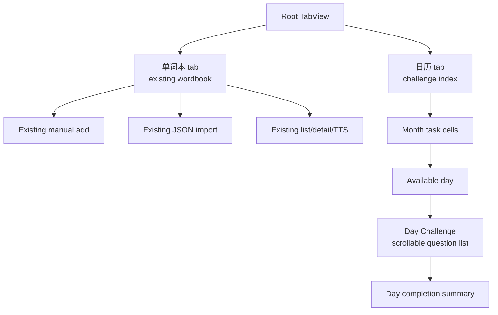

# Word Calendar: Owner-Approved v1 Implementation Design

- **Status:** `Owner-approved v1 implemented on zhangzhe/issue-6 — approved and implemented 2026-10-20.`
- **Audience:** WordMem product owner, design reviewer, and implementation reviewer.
- **Baseline:** `a94eb25`, the current local wordbook implementation.
- **Approval boundary:** This revision records the owner-approved implementation scope. It does **not** authorize changes to Swift source, Xcode project files, `Info.plist`, entitlements, or tests; those implementation artifacts require their own normal engineering/review workflow.
- **Source decision:** The owner approved the v1 scope on **2026-10-20** and described calendar-based review. The phrase “Camera 栏” is therefore interpreted as **“Calendar 栏”**: it refers to the new Calendar tab, not photography, image capture, or a Camera tab.

## 1. Decision summary

v1 uses a root `TabView` with **exactly two tabs**:

1. **单词本** — the existing wordbook experience, preserved.
2. **日历** — the complete challenge index and entry point for day Challenges.

There is no Home, Say It, Question, Feedback, Camera, Settings, Profile, Statistics, Review, or other tab in v1. A Challenge is a destination reached from a calendar-day task cell, not a dashboard or another tab. It shows the selected day's expected review words as one scrollable question list with mixed forms.

The v1 experience remains local/offline. It reads the existing `saved_words` / `WordData` payload, never rewrites its schema, and adds no account, cloud, backend, analytics, social, or network dependency. **Microphone capture and speech recognition are out of v1 scope.** A listening item may use existing on-device TTS playback only. Any future speech capture or camera work remains out of scope until separately approved and implemented.

## 2. Owner decision and interpretation

### 2.1 Approved on 2026-10-20

| Decision | Approved v1 meaning |
| --- | --- |
| Root information architecture | A root `TabView` with exactly the two named tabs: existing 单词本 and new 日历. |
| Calendar role | The complete challenge index. Every local calendar day appears as a task cell in the month view. |
| Challenge role | Tapping an available day opens that day's Challenge as a scrollable question list. |
| Challenge form | Question list with mixed question forms for the day's expected review words. It is not a separate dashboard. |
| Listening | Existing on-device TTS playback may be used. No microphone, recording, transcript, or speech-recognition flow. |
| Camera wording | “Camera 栏” is treated as a wording error for “Calendar 栏.” No Camera feature or tab is approved. |
| Compatibility | Existing wordbook behavior and `saved_words` compatibility must be preserved. |

### 2.2 Explicit interpretation record

The owner's description of calendar-based review resolves the wording ambiguity. Any text that could be read as “Camera 栏” means the **Calendar 栏**. v1 has no camera UI, camera permission, photo capture, image ingestion, OCR, or camera tab. Any future capture concept, including issue #5 capture and speech capture, requires a new dated owner approval and design review.

## 3. v1 scope

### 3.1 In scope

1. Root two-tab IA: 单词本 and 日历.
2. Calendar month index with one task cell per local calendar day.
3. Day availability, selection state, and day-to-Challenge navigation.
4. Day Challenge as a scrollable question list.
5. Mixed local question forms across the day's expected review words.
6. Answer feedback, retry/hint rules, progress, and completion states.
7. On-device TTS replay for the listening form when a suitable local voice exists.
8. Preserve existing wordbook add/import/list/detail behavior and `saved_words` compatibility.
9. iOS 15-compatible SwiftUI patterns, accessibility, Dynamic Type, and zh-CN-primary copy.
10. This markdown design and the static offline HTML prototype.

### 3.2 Out of scope for v1

- Home, Say It, Question, Feedback, Camera, Settings, Profile, Stats, Streak, Shop, Feedback, and any additional tab.
- Microphone permission, recording, audio capture, speech recognition, speech scoring, transcripts, or pronunciation checking.
- Camera permission, photo capture, document capture, image import, OCR, or camera-related configuration.
- Accounts, sign-in, cloud sync, backend services, remote notifications, analytics, telemetry, ads, sharing, social features, or paid features.
- Changes to `saved_words` schema, import semantics, manual-add behavior, detail behavior, or existing wordbook controls.
- Network/model-generated content, licensed media, or external prototype assets.
- Reminders, freeze economics, deep gamification, leaderboards, or long-term monetization systems.

### 3.3 Compatibility contract

| Existing surface | v1 must preserve |
| --- | --- |
| Root empty state | “暂无单词 / 添加一个单词，或导入 JSON 单词本” remains available and explanatory. |
| Word list and detail | Existing rows, detail fields, and `AVSpeechSynthesizer` playback behavior remain reachable from 单词本. |
| Manual add | Existing plus-menu path opens `AddWordView`; required word/translation validation remains unchanged. |
| JSON import | Existing file importer, parsing, replacement, success/failure alerts, and main-queue UI updates remain unchanged. |
| `saved_words` | `WordData` remains the canonical wordbook payload. Calendar may derive a read-only local schedule but must not rewrite or relocate it. |
| Add replacement and import deletion | Existing exact-word replacement and `WordData.id` deletion behavior remain unchanged. |
| Offline behavior | All v1 screens operate locally with no network call or connectivity requirement. |

## 4. Information architecture

### 4.1 Exact two-tab model

Tab rules:

1. The tab bar contains exactly two buttons: **单词本** and **日历**.
2. 日历 is selected when the user is viewing the month or a Day Challenge.
3. Challenge is a pushed destination from a selected day; it does not create a tab and cannot be selected directly from the tab bar.
4. Back/ Done returns to 日历 and preserves the selected local day.
5. Existing wordbook controls remain within 单词本 and are not moved into Calendar.

### 4.2 Screen inventory

| ID | Screen | Purpose | Key states |
| --- | --- | --- | --- |
| W0 | 单词本 | Preserve the existing wordbook | Empty; list; detail; add; import success/failure; offline-safe |
| C0 | 日历 / month index | Show every local day as a task cell | Today; complete; partial; available recovery; no tasks; future; today-not-yet-available; data warning |
| D0 | Day Challenge | Work the selected day's expected review words | Scroll list; answered; feedback; retry/hint; skipped; partial complete; all complete; no TTS voice |
| E0 | Local repair state | Protect the wordbook and local progress | Corrupt progress isolated; explicit reset; `saved_words` untouched |

## 5. Calendar day-to-Challenge state map

All cells use the user's local calendar and local midnight. A day cell is a task cell, not merely a heat tile. The calendar is the complete index; a Challenge is opened only by selecting an available day.

| Local day state | Task-cell presentation | Tap result |
| --- | --- | --- |
| No expected words | Neutral cell with “无” or equivalent accessible label | No Challenge opens; explain that no review task exists. |
| Complete | Moss check + “已完成” | Opens read-only/redo-safe Challenge summary, unless product explicitly disables reopen. Default v1: reopen for review without resetting completion. |
| Partial | Check with remaining count “还剩 N” | Opens Challenge focused on the first unanswered expected word. |
| Available past recovery | Coral marker + “可恢复” | Opens recovery Challenge for that past day's remaining words. |
| Today ready | Amber/blue accent + “今日 N” | Opens today's Challenge. |
| Today no queue | Neutral “暂无任务” | No Challenge opens; wordbook remains available. |
| Future scheduled | Slate outline + count/date, disabled until local day begins | Not tappable in v1; no future work is performed or marked. |
| Rollover boundary | Recompute after local midnight/DST change | Previously available/current states update without duplicating history. |
| Progress corrupt | Warning state in Calendar | Isolate progress from `saved_words`; offer explicit local reset; never auto-delete wordbook. |

State-map acceptance rules:

1. Every rendered local date in the month has exactly one task cell.
2. Complete, partial, recovery, and ready days are visibly available and tappable.
3. Future days cannot start a Challenge or write completion data.
4. Past days with remaining work remain available as recovery rather than disappearing.
5. Day status comes from local expected-review and progress snapshots, never from network time or cloud state.
6. Selecting another month/date updates the detail and Challenge target atomically.

## 6. Day Challenge: question-list design

### 6.1 Structure

A Day Challenge is the selected day's review work in one screen. It has a compact header (day, status, progress, back-to-Calendar) and one vertically scrollable list of question cards. There is no separate dashboard, no tab replacement, and no requirement to visit a Home screen first.

Each expected review word receives one primary question card. The engine assigns a form based on the word's available fields and prior local progress, while deliberately mixing forms across the list. Missing optional fields cause a deterministic fallback rather than a blank card.

### 6.2 Mixed question forms

At least the following four forms are mixed in v1. A listening item uses TTS only.

| Form | Prompt | Correct rule | v1 fallback |
| --- | --- | --- | --- |
| Meaning match | Show the English word; choose its zh-CN meaning. | Selected option ID matches. | Self-check reveals answer and asks “认识 / 还不熟.” |
| Listening choice | Play existing on-device TTS; choose the matching word or meaning. | Correct option selected; replay is allowed. | If no suitable local voice, convert to text/audio-label choice or meaning match; never require a microphone. |
| Reverse translation | Show zh-CN meaning; type the English word. | Normalized local comparison ignores case and edge punctuation. | Reveal first/last letter, then reveal answer as a learning retry. |
| Context/cloze choice | Show a local example with one slot; choose the completion. | Selected slot matches. | Drop the form when no nonempty local example exists. |
| Spelling | Show meaning/audio cue and spell the English word. | Exact normalized string. | Letter shape (`a p p _ _`), then reveal and mark a lapse. |
| Self-check | Show word and meaning; user reports recognition. | Explicit user choice. | Used only when content cannot support another listed form. |

Distractors are generated locally from the existing wordbook by initial, length, part of speech/domain, or prior confusion. They must never require network or duplicate the correct answer. If the wordbook cannot supply enough real distractors, use self-check rather than inventing backend content.

### 6.3 Question-list interaction rules

1. Cards are ordered perception → recall → production where content allows, with no same form appearing more than twice consecutively.
2. The list shows answered status and preserves scroll position; returning from interruption restores the first unanswered card.
3. Selecting a choice submits immediately and shows inline feedback under that card.
4. Text input uses a clearly labeled check button; keyboard submit has the same behavior.
5. Correct feedback states “答对了” and the next review day in plain zh-CN.
6. Wrong feedback states “再想想”, shows the correct answer/context, and offers retry where the form supports it.
7. Hint ladder: remove one choice or replay slowly → word shape/example cue → reveal answer as a learning retry. At most two hints before reveal.
8. A skipped/revealed card remains visible and counts as not retained; it does not silently disappear.
9. Progress persists after each submitted card, not only at session end.
10. Leaving after an answered boundary preserves that answer; an unanswered item is not marked wrong.
11. When all expected cards are resolved, the Challenge shows completion: completed, retained, repaired, skipped, and remaining/next-day information.
12. Every feedback pairs color with text/icon and has an accessibility label/value; minimum primary target is 44×44 pt.
13. “完成” returns to the same selected day in Calendar; it does not switch to another tab.

### 6.4 Day completion states

| State | Required response |
| --- | --- |
| All retained | Brief “今日任务完成” summary and tomorrow's predicted count. |
| Partial | “已完成 N / M”; remaining cards can be resumed from the same day cell. |
| Skips/reveals included | Distinguish retained, repaired, and skipped words without shaming the user. |
| Past recovery | Label the header as recovery for that local date. |
| One-word day | A complete loop works and does not claim variety. |
| No local TTS voice | Listening converts to an equivalent text/self-check item; start is not blocked. |

## 7. SwiftUI screen/state specification

### 7.1 Architecture implications

- Use iOS 15-compatible SwiftUI primitives (`TabView`, `NavigationView`, `NavigationLink`, `sheet`, `alert`, `Form`, and system controls).
- The root redesign is limited to introducing the approved two-tab structure.
- 单词本 embeds the existing protected wordbook paths without changing their contracts.
- 日历 owns the month state and presents Day Challenge as a destination.
- Isolate deterministic queue/question logic, local progress persistence, clock/calendar, and TTS behind injectable protocols for future tests.
- Use local-calendar day identifiers; do not infer days from `createDateString` or mutable displayed text.

### 7.2 State and transition rules

| Screen/state | Rule | Allowed next state |
| --- | --- | --- |
| 单词本 ready | Existing add/import/list/detail remains available. | Existing detail/add/import |
| 单词本 empty | Existing empty copy and paths remain available. | Existing add/import |
| 日历 month | Render one task cell per local day; show selected-day detail. | Available Day Challenge; month change |
| Available day selected | Focus/count/readiness is visible. | Day Challenge |
| Future day selected | Cell is disabled and explains availability. | No transition |
| Challenge in progress | One scrollable mixed-form list; progress persists per submitted card. | Feedback / next card / Complete / Calendar |
| Challenge no TTS | Convert listening form; do not show permission/error as a blocker. | Question list |
| Challenge complete | Show honest summary and return target. | Calendar / wordbook |
| Progress corrupt | Isolate from wordbook; explicit repair/reset required. | Calendar repaired state |

### 7.3 Core edge states

| State | Required behavior |
| --- | --- |
| Empty wordbook | Calendar explains no tasks yet; protected add/import remains in 单词本. |
| One word | Challenge works; use self-check or local wordbook distractor policy, never fake backend data. |
| Offline | No network banner or dependency; local TTS works if available. |
| Missing fields | Drop cloze/context and use the approved fallback ladder. |
| Duplicate/case-variant words | Use `WordData.id` first with normalized fallback; ambiguous progress is quarantined. |
| Import/deletion | Preserve old wordbook behavior; carry or quarantine local progress only under an explicit identity policy. |
| Interruption | Persist answered boundary; restore to first unanswered expected word. |
| DST/rollover | Recompute from local calendar; do not duplicate or silently reassign history. |
| Corrupt progress | Do not touch `saved_words`; offer explicit reset and recovery. |
| iPad/regular width | Same IA with constrained content width; exact two tabs remain. |

## 8. Accessibility, localization, and interaction

1. zh-CN is primary; user-facing labels use 单词本, 日历, 今日, 已完成, 可恢复, and 挑战 consistently.
2. Every calendar cell has an accessible value such as “10月20日，今日还剩3个，可打开挑战” or “10月21日，未来任务，不可用.”
3. Correct/wrong, TTS playing, retry, hint, reveal, and completion are announced through accessibility labels/live regions.
4. Color is never the only status signal.
5. Buttons and options are at least 44×44 pt with separated hit areas; focus order is header → progress → current question → options/input → hint → skip/submit.
6. Reduce Motion removes nonessential animation. Dynamic Type must not truncate prompts or answers.
7. Haptics/sound are optional and local only; they never replace text feedback.
8. Plain privacy copy remains: “记录只保存在这台 iPhone 上。”.

## 9. Local data and privacy boundary

### 9.1 Compatibility boundary

- `saved_words` / `WordData` remains the canonical local wordbook source.
- Day queues are derived read-only from a local wordbook snapshot and stable local progress records.
- Progress is stored separately from `WordData`, versioned locally, and must tolerate schema evolution without corrupting the wordbook.
- Question forms and distractors derive only from fields already available on device.

### 9.2 Data lifecycle

1. Word add/import/deletion must continue exactly as today.
2. A schedule snapshot may be regenerated after a wordbook change; submitted answers retain their word identity where unambiguous.
3. Ambiguous identity changes are quarantined rather than guessed.
4. Deleting the app deletes only local app data; there is no remote copy.
5. No analytics event, network ping, cloud backup, account, or social payload is introduced.

## 10. TTS-only listening rule

- A listening item may call the existing on-device speech synthesis path for an English word or a phrase already present in local content.
- Replay and slow replay are visible, accessible actions when supported.
- The prototype and implementation must degrade predictably when no suitable voice is installed.
- No microphone permission, `AVAudioSession` record category, recording indicator, transcript, recognizer, or pronunciation score may be added in v1.
- This rule does not remove the existing wordbook detail TTS behavior.

## 11. Implementation acceptance criteria

An implementation conforms to the owner-approved v1 scope only if all of the following are true:

1. The root has exactly two tabs: 单词本 and 日历. Automated/UI inspection finds no other tab-bar item.
2. The 日历 month view renders each local calendar day as a task cell with an accessible state.
3. Tapping each complete, partial, recovery, or ready day opens that specific day's Challenge.
4. Future and no-task days do not open a writable Challenge.
5. Day Challenge is one scrollable list of expected review words and is not a dashboard.
6. The list contains mixed approved question forms; at least meaning match, TTS listening, reverse translation, and context/cloze or spelling appear when content supports them.
7. Answer feedback, retry, hint, skip/reveal, persistence, resume, and completion follow section 6.3.
8. Existing wordbook empty/add/import/list/detail behavior remains unchanged and reachable in 单词本.
9. `saved_words` / `WordData` schema and semantics remain compatible; Calendar reads rather than mutates them.
10. The app works offline with no external asset/backend/account/analytics/social dependency.
11. No microphone/speech recognition or camera permission/UI/configuration is present in v1.
12. Local-day rollover/DST, interruption, one-word, empty-wordbook, missing-field, and corrupt-progress behavior pass the specified edge rules.
13. Dynamic Type, VoiceOver labels/values, 44 pt targets, non-color status cues, and zh-CN-primary copy pass review.
14. No Swift, project, `Info.plist`, entitlement, or test file is changed as part of approving this design package.

## 12. Static prototype acceptance criteria

`04-word-calendar-prototype.html` conforms when:

1. It opens directly offline in a modern browser with no external scripts, fonts, images, network calls, or analytics.
2. It visually demonstrates exactly two bottom tabs: 单词本 and 日历.
3. The 日历 tab shows a tappable month calendar with local-day task cells and state labels.
4. Tapping an available day opens that day's Challenge question-list screen.
5. The Challenge demonstrates at least three mixed question forms, including a TTS-only listening form or its explicit no-voice fallback.
6. Answer/feedback/progress/completion interactions are visible without a backend.
7. The 单词本 tab preserves representative existing list/add/import/detail/TTS behavior and does not imply that Calendar changes it.
8. No Home, Say It, Question, Feedback, Camera, Settings, or other bottom tab appears.
9. The prototype labels the revised scope as owner-approved for implementation on 2026-10-20.

## 13. Residual future work

The following are explicitly **not approved or implemented in v1**:

- Speech capture, microphone access, recording, speech recognition, pronunciation scoring, or transcripts.
- Camera access, photo/document capture, image import, OCR, or visual word lookup.
- Reminders, deep gamification, freeze policies, advanced SRS tuning, export/backup, and settings surfaces beyond what v1 requires.
- Accounts, cloud/backend processing, analytics, social comparison, sharing, ads, or paid repair.

Each item requires a separately dated owner-approved scope, privacy review, platform permission review, and implementation acceptance criteria. Approval of this Calendar-as-Challenge v1 scope does not imply approval of any future capture modality.

## 14. Implementation record

On 2026-10-20, the approved v1 scope was implemented on `zhangzhe/issue-6` from baseline `a94eb25`. The root now contains only the 单词本 and 日历 tabs; the original wordbook path is preserved as `WordbookView`. Challenge models, deterministic local-day scheduling, injectable `UserDefaults`, clock/calendar dependencies, due selection, question generation, and versioned progress persistence are isolated in `CalendarChallengeService.swift`. Calendar and day Challenge presentation are isolated in `CalendarChallengeViews.swift`.

Unit coverage includes Asia-local day keys, schedule selection across missed and future days, stable mixed-question generation, progress reload/isolation from `saved_words`, completion transition persistence, and existing `LocalStorageManager` compatibility. The implementation passed `plutil -lint WordMem/Info.plist` and the required iOS Simulator `xcodebuild test` command.
